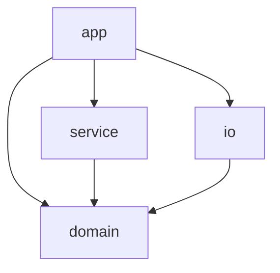
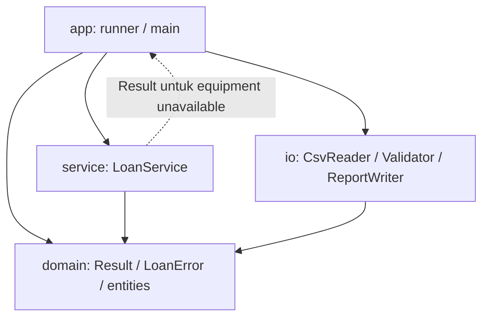

# Laporan Praktikum Modul 3 — Lab 3

## 3.1 Keputusan klasifikasi: EquipmentUnavailable

Prediksi sebelum implementasi dicatat di `PREDICTION.md`.

Keputusan yang diuji: kondisi equipment sedang dipinjam adalah outcome operasional
normal, sehingga `LoanService::borrow()` mengembalikan `Result<Loan>` dengan
`ok == false` dan pesan `Equipment already on loan: <tag>`. Kegagalan lain yang
merupakan pelanggaran request atau aturan bisnis tetap menggunakan exception
bertipe.

Padanan perilaku lama dipertahankan hanya sebagai adapter pengujian
`borrowThrowingForComparison()` / `borrow_throwing_for_comparison()`. Adapter
tersebut bukan jalur produksi; ia dipakai untuk membuktikan bahwa pesan kegagalan
Result sama dengan pesan `EquipmentUnavailable` versi throwing.

Test yang memverifikasi kecocokan terdapat pada `cpp/tests/test_result.cpp` dan
`py/tests/test_result.py`. Implementasi mengadaptasi empat call expression produksi
per bahasa seperti diprediksi: tiga pemanggilan pada seeding dan satu pemanggilan
pada row loop app. Call site test yang membutuhkan objek `Loan` juga membuka nilai
sukses melalui `value()` / `.value`. `Equipment::markLoaned()` tetap mempunyai
exception guard defensif untuk pelanggaran invariant pada operasi mutasi langsung;
jalur normal `LoanService::borrow()` mengklasifikasikan status unavailable sebelum
mutasi sebagai `Result.failure`.

### Diff aktual dari working tree mahasiswa

Berikut adalah output `git diff --stat` yang dijalankan setelah perubahan Lab 3
diterapkan pada branch `m3-work` (dan setelah file baru dimasukkan ke diff
menggunakan `git add -N .`):

```text
 APPLY_LAB3.md                                  |  60 ++++++++++
 LAB3_REPORT.md                                 | 150 +++++++++++++++++++++++++
 README.md                                      |  49 +++++++-
 REPRODUCE_FROM_CLEAN.md                        |  55 +++++++++
 cpp/include/pinjamlab/app/runner.hpp           |   8 +-
 cpp/include/pinjamlab/app/seed.hpp              |   6 +-
 cpp/include/pinjamlab/domain/loan.hpp           |   6 +-
 cpp/include/pinjamlab/service/loan_service.hpp  |  32 +++++-
 cpp/tests/test_errors.cpp                      |  23 ++--
 cpp/tests/test_raii.cpp                        |   2 +-
 cpp/tests/test_result.cpp                      |  36 ++++++
 docs/dependency-graph-after.mmd                |   6 +
 docs/dependency-graph-before.mmd               |   6 +
 evidence/asan_lab3_after.txt                   |   2 +
 evidence/asan_lab3_before.txt                  |  12 ++
 evidence/dependency_rule_negative_test.txt     |  17 +++
 evidence/lab3_clean_clone_run_tests_linux.txt  |  80 +++++++++++++
 evidence/lab3_run_tests_linux.txt              |  80 +++++++++++++
 py/pinjamlab/app/runner.py                     |   8 +-
 py/pinjamlab/app/seed.py                       |   6 +-
 py/pinjamlab/service/loan_service.py           |  22 +++-
 py/tests/test_cleanup.py                       |   2 +-
 py/tests/test_errors.py                        |  22 ++--
 py/tests/test_result.py                       |  30 +++++
 run_tests.sh                                   |  39 +------
 scripts/check_dependencies.py                 | 124 ++++++++++++++++++++
 26 files changed, 798 insertions(+), 85 deletions(-)
```

Ringkasan diff aktual: **26 file berubah, 798 baris ditambahkan, dan 85 baris
dihapus**. Perubahan kode produksi utama berada pada `LoanService`, runner app,
dan proses seeding di C++ serta Python. Perubahan lain meliputi regression test,
checker dependency rule, graf dependensi, dokumentasi, dan bukti pengujian.

Prediksi di `PREDICTION.md` menyebut empat call expression produksi per bahasa
perlu diadaptasi: tiga pemanggilan pada seeding dan satu pada row loop app.
Implementasi mengubah file seeding dan runner pada kedua bahasa, sesuai lokasi
yang diprediksi. Jumlah baris pada `git diff --stat` sendiri tidak membuktikan
jumlah call expression; kecocokan jumlah empat call expression dikonfirmasi dengan
meninjau perubahan kode pada kedua file tersebut. Call site test yang mengonsumsi
nilai `Loan` juga harus membuka hasil sukses melalui `value()` / `.value()`.

## 3.2 Empat lapisan dan dependency rule

### Kondisi sebelum perubahan

Repository dosen yang diterima sudah memisahkan file ke dalam empat direktori
`domain`, `service`, `io`, dan `app`. Karena itu tidak ada satu god file 900 baris
yang dapat dipecah kembali pada snapshot aktual ini. Struktur awal dicatat apa
adanya; laporan tidak mengklaim bahwa file sudah dipindahkan ketika faktanya
memang sudah modular.

Graf dependensi yang ditemukan pada kode awal:



### Kondisi sesudah perubahan



Arah dependensi tetap mengarah ke dalam: `app` boleh memakai `service`, `io`,
dan `domain`; `service` memakai `domain`; `io` memakai `domain`; `domain` tidak
mengimpor atau meng-include tiga lapisan luar. Refactor perilaku Lab 3.1 tidak
membuat domain mengetahui CSV, file, atau console.

File bukti graf:

- `docs/dependency-graph-before.mmd`
- `docs/dependency-graph-after.mmd`

Pemeriksaan kemurnian dijalankan melalui `scripts/check_dependencies.py` dan
menjadi langkah wajib `run_tests.sh`. Pemeriksaan ini memeriksa include C++ dan
import/call Python pada domain, termasuk larangan dependensi ke `io`, `service`,
`app`, serta I/O file/console langsung. Pengujian negatif saat penyusunan paket
juga menyisipkan sementara include/import `domain -> io`; checker menolak kedua
pelanggaran tersebut seperti yang diharapkan.

## 3.3 Baseline dan perbandingan

### A. Strategi penanganan: satu catch-all besar vs bertingkat dan bertipe

| Mode kegagalan | Catch-all: tertangkap? | Catch-all: pesan berguna? | Catch-all: leak? | Catch-all: exit code? | Bertingkat/bertipe: tertangani? | Bertingkat: pesan berguna? | Bertingkat: leak? | Bertingkat: exit code? |
|---|---|---|---|---|---|---|---|---|
| Field whitespace-only | Tidak jika dikembalikan sebagai `Result` dan hasilnya diabaikan; jika dilempar akan tertangkap | Tidak; detail validator hilang | Tidak dengan RAII; catch-all sendiri tidak menjamin cleanup | Berisiko `0` jika kesalahan diabaikan | Ya, `Validator` menghasilkan `Result.failure` dan app memeriksa `ok` | Ya, pesan dan nomor baris dicatat | Tidak dengan RAII/context manager | `1` jika ada baris ditolak |
| Identifier tidak kanonis | Sama: `Result` tidak ditangkap catch | Tidak | Tidak dengan RAII; bukan fungsi catch | Berisiko `0` jika diabaikan | Ya, validator di boundary | Ya, format kanonis dan nilai yang salah dilaporkan | Tidak dengan RAII/context manager | `1` |
| Integer di luar rentang | Sama: `Result` tidak ditangkap catch | Tidak | Tidak dengan RAII; bukan fungsi catch | Berisiko `0` jika diabaikan | Ya, validator memeriksa sebelum konversi | Ya, nilai dan batas rentang dilaporkan | Tidak dengan RAII/context manager | `1` |
| UnknownAssetTag / UnknownMember | Ya, sebagai exception | Tidak jika catch kosong; konteks tag/ID hilang | Tidak dengan RAII/context manager; catch-all bukan cleanup | Berisiko `0` jika error ditelan | Ya, `LoanError` bertipe sampai app | Ya, tag atau ID disertakan | Tidak dengan RAII/context manager | `1` |
| InvalidLoanDuration | Ya, sebagai exception | Tidak jika catch kosong | Tidak dengan RAII/context manager | Berisiko `0` jika error ditelan | Ya, exception bertipe; format angka sudah divalidasi di io | Ya, durasi dan batas maksimum disertakan | Tidak dengan RAII/context manager | `1` |
| EquipmentUnavailable | Tidak pada jalur baru karena ini `Result.failure`, bukan exception | Tidak jika `Result` diabaikan | Tidak dengan RAII/context manager | Berisiko `0` jika `Result` diabaikan | Ya, app memeriksa `borrowed.ok()` / `borrowed.ok` | Ya, pesan status equipment disertakan | Tidak dengan RAII/context manager | `1` |
| ReservationConflict | Ya, sebagai exception | Tidak jika catch kosong; owner dan peminta hilang | Tidak dengan RAII/context manager | Berisiko `0` jika error ditelan | Ya, handler spesifik memakai data exception | Ya, tag, pemegang reservasi, dan peminta dicatat | Tidak dengan RAII/context manager | `1` |
| QuotaExceeded | Ya, sebagai exception | Tidak jika catch kosong; active/limit hilang | Tidak dengan RAII/context manager | Berisiko `0` jika error ditelan | Ya, handler keluarga `LoanError` | Ya, jumlah aktif dan batas disertakan | Tidak dengan RAII/context manager | `1` |
| FineCapReached | Ya, sebagai exception | Tidak jika catch kosong; calculated/cap hilang | Tidak dengan RAII/context manager | Berisiko `0` jika error ditelan | Ya, handler spesifik di app | Ya, loan ID, nilai hitung, dan cap disertakan | Tidak dengan RAII/context manager | Exit non-zero untuk operasi/command yang melaporkan penolakan; helper display sendiri mengembalikan pesan |

**Catatan leak dan exit code:** strategi catch tidak dengan sendirinya menjamin
bebas leak. Pada kode ini, cleanup transaksi ditangani oleh RAII/context manager.
Catch-all kosong dapat membuat proses tampak berhasil dan exit code tetap `0`,
sedangkan handler aplikasi menambah jumlah penolakan dan mengembalikan exit code
`1` untuk file yang mengandung baris gagal. `Result` juga harus diperiksa secara
eksplisit; `catch (...)` tidak dapat menangkap kegagalan yang dikembalikan.

### B. Mekanisme cleanup: C++ RAII vs Python `with`

| Aspek | C++ `TxnGuard` | Python `txn_guard` |
|---|---|---|
| Implementasi helper | `cpp/include/pinjamlab/service/txn_guard.hpp` (48 baris file, termasuk komentar) | `py/pinjamlab/service/txn_guard.py` (32 baris file, termasuk komentar) |
| Bentuk call site | Objek guard lokal dibuat; `commit()` dipanggil eksplisit saat sukses | Satu compound statement `with txn_guard(db) as db:` membatasi region |
| Cleanup saat exception | Destructor berjalan saat stack unwinding; rollback jika belum commit | Interpreter memanggil `__exit__`; context manager rollback lalu `raise` ulang exception |
| Jika pemanggil lupa | Jika guard tidak dibuat/objek raw dipakai, tidak ada proteksi; setelah guard lokal dibuat, scope exit menjalankan destructor | Jika pemanggil lupa memakai `with`, `__enter__`/`__exit__` tidak dijalankan; jaminan hilang |
| Penegakan | Destructor terikat pada lifetime objek; guard non-copyable; destructor `noexcept` | Jaminan terikat pada statement `with`; tidak ada pemeriksaan tipe statis yang mewajibkannya |
| Hasil test error path | `test_raii.cpp` memverifikasi pending record di-rollback ketika exception unwind | `test_cleanup.py` memverifikasi rollback dan exception diteruskan |

Jumlah baris di atas adalah panjang file saat paket disusun, bukan perbandingan
jumlah baris logika murni. Call site nyata dapat dilihat dalam `LoanService::borrow`
dan `LoanService.borrow`.

## 3.4 Reproduce-from-clean

Ikuti `REPRODUCE_FROM_CLEAN.md`. Rekan harus clone branch `m3-work` dari remote,
menjalankan hanya `./run_tests.sh`, dan mendapatkan kedua golden output serta
exit code yang ditentukan. Hasil clean clone harus dicatat setelah benar-benar
dijalankan; laporan ini tidak mengklaim clean-clone pihak kedua sudah dilakukan
oleh pembuat paket.

## Hasil verifikasi paket saat disusun

Paket diuji secara lokal di lingkungan Linux dengan:

- GNU g++ 14.2.0
- Python 3.13.5
- pytest 9.0.2

Hasil: C++ exception 12 test passed; C++ RAII 4 passed; C++ Result 7 passed;
C++ app 5 passed; Python 31 passed; dua golden-output match; AddressSanitizer
mendeteksi raw-pointer leak pada demonstrasi awal dan jalur `unique_ptr` bersih.

Hasil tersebut adalah verifikasi lingkungan penyusunan paket, bukan pengganti
pengujian ulang di Windows/MinGW pada komputer mahasiswa. Simpan output aktual
Windows sebagai bukti final.
